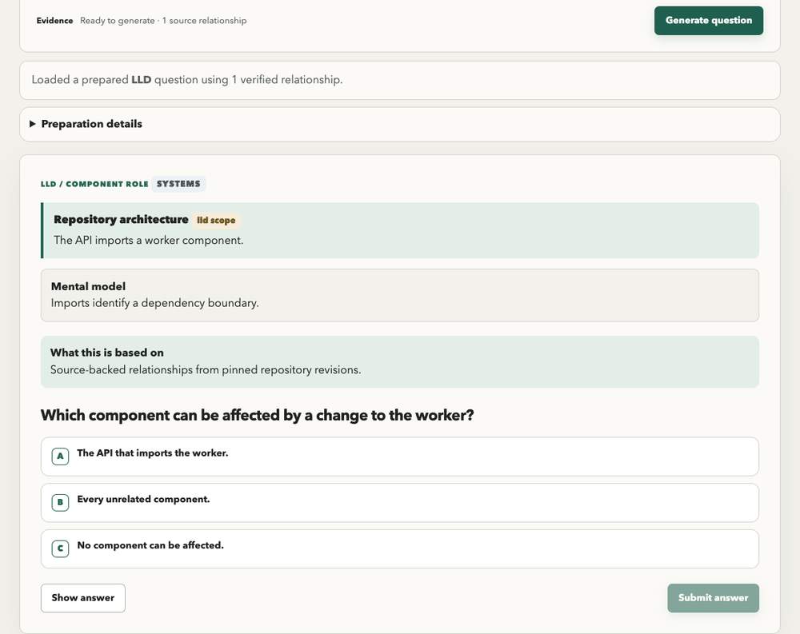
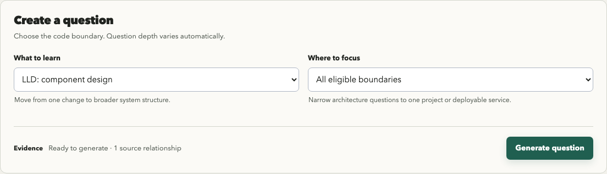
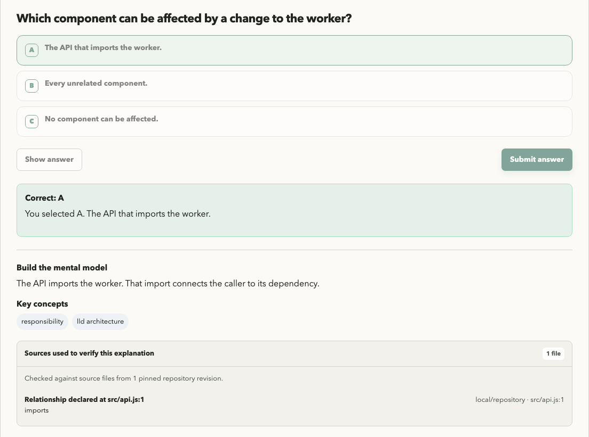

<picture>
  <source media="(prefers-color-scheme: dark)" srcset=".github/assets/banner-dark.svg">
  
</picture>

Keep up with the code your agents write. Codebase Trail turns committed repository code and merged PRs into practice questions. Answer first, check the source-backed explanation, and revisit what surprised you.

Codebase Trail is a Node.js app that runs on your computer and opens its interface in your browser. It uses your chosen model to create and review questions. No Codebase Trail account or hosted service is required.

[](docs/technical-reference.md)
[](LICENSE)

<a href="https://www.producthunt.com/products/agentic-workflow-kit?embed=true&amp;utm_source=badge-featured&amp;utm_medium=badge&amp;utm_campaign=badge-tetriz-engineering-kit" target="_blank" rel="noopener noreferrer"></a>



Choose → answer → explain → verify. Synthetic repository and fixed local model.

## Quick start

**Use the release installer.** Install Git separately and have a committed Git checkout to practice on. The installer downloads Node.js and npm into your user folder; you do not need to install them first. Models and model CLIs are not bundled.

Use GitHub CLI to download the release assets, then follow your operating system's checksum and launch instructions:

| Your computer | Install |
| --- | --- |
| macOS 13.5+, Apple Silicon or Intel | [macOS installer](docs/install.md#macos-installer) |
| Windows 10+ x64, or Windows 11 ARM64 with x64 emulation | [Windows installer](docs/install.md#windows-installer) |

Native installation is verified on macOS Apple Silicon. Windows and macOS Intel installers are available for preview testing; native verification is pending.

The installer opens the app after installation. In **Settings**, select the repository you want to learn and your model: an installed, signed-in Claude Code or Codex CLI, or a supported model API. A local OpenAI-compatible model is also supported. Choose where source evidence may go, then click **Save and start learning**.

On the learning page, choose a topic in **What to learn** and click **Generate question** once indexing finishes. The same dropdown switches between component design, service dependencies, repository topology and pull requests. You do not repeat setup when switching topics.

PR practice additionally requires a checkout with a github.com remote and a signed-in GitHub CLI (`gh`) account. Local architecture practice needs no GitHub account. Settings identifies missing prerequisites.

For later launches, use the launcher path printed by the installer. The [installation guide](docs/install.md) lists the macOS and Windows launch paths. [Model requirements](docs/usage.md#models) cover supported providers and model IDs.

## How practice works



Choose an answer before revealing the explanation. Inspect the source references when a dependency surprises you, then open the attempt in **History** to revisit your answer and notes.



Questions use source from pinned Git revisions. The app validates citations and asks a model to review each candidate before showing it. If the evidence or model output cannot support a question, the app explains why it could not publish one.

Answers help avoid repeats. Feedback ratings and notes are saved for your review; they do not adapt future questions. The [practice guide](docs/usage.md#understand-your-question) explains question types, source requirements and history.

Screenshots show the actual app. The screenshots and UI demo use synthetic repository code and fixed model responses to demonstrate the experience, not model accuracy.

## Before you rely on it

- **Local app does not mean local inference.** Remote APIs and signed-in Claude/Codex CLIs receive bounded source evidence. Use a loopback model endpoint declared local in Settings to keep inference on your machine. Remote API endpoints require HTTPS; plain HTTP is accepted only on loopback.
- **Check the answer against the code.** Citation validation and model review do not prove an explanation correct or measure learning gains.
- **Only committed source is included.** Uncommitted edits, untracked files and complete runtime behavior are outside the source snapshot. Large repositories can exceed indexing limits.
- **Coverage has boundaries.** Built-in extraction covers selected patterns in JavaScript/TypeScript, Go, Python, Java, Kotlin, Rust, Ruby and C#, plus selected contract and infrastructure declarations. Service and repository-topology questions need enough connected service relationships. PR practice supports github.com.

See [coverage and platform boundaries](docs/coverage.md) for supported patterns and limits.

Settings, credentials, canonical answer records and caches live in your user profile. Full explanations are saved in browser storage; export them from History before clearing browser data or changing browsers. See the [storage reference](docs/usage.md#evidence-and-storage).

API keys entered in Settings are saved as plaintext in `settings.json` in that profile directory, with restricted file permissions where supported. Keys are not encrypted or stored in the operating system keychain; the [storage reference](docs/usage.md#evidence-and-storage) also explains older credential files. Use a signed-in model CLI or environment variables if you do not want the app to save API keys.

## For contributors

To work on the app, follow [source setup and checks](CONTRIBUTING.md#run-from-source). The [extractor SDK workflow](CONTRIBUTING.md#adding-an-extractor) lets contributors add support for source conventions. It is separate from configuring a repository in Settings.

<details>
<summary>Offline terminal example for source checkouts</summary>

After following [source setup](CONTRIBUTING.md#run-from-source), this [example](examples/practice-a-boundary/) prints a synthetic question and answer. It does not open the browser UI or analyze your repository. No model account or credential is needed.

```sh
node examples/practice-a-boundary/main.mjs
```

```text
Fixed model responses demonstrate the pipeline and output format, not model accuracy.
Which component can be affected by a change to the worker?
Answer A: The API that imports the worker.
Grounded claims: 1
```

</details>

The [examples folder](examples/README.md) contains three complete offline programs. The [technical reference](docs/technical-reference.md) documents development APIs and engine contracts.

## Project

Version 0.1.0 is a maintained preview. Commands, configuration and history/export formats may change in minor releases before 1.0. Breaking changes are recorded in the [changelog](CHANGELOG.md).

- Contributions follow [CONTRIBUTING.md](CONTRIBUTING.md) and the [code of conduct](CODE_OF_CONDUCT.md).
- Follow the [security policy](SECURITY.md) to report vulnerabilities privately.
- GitHub Actions remains disabled. Maintainers run the [local checks](CONTRIBUTING.md#checks) manually and use the [release guide](docs/releases.md) to prepare, validate and publish GitHub release assets. Checked-in workflows are references only.
- Codebase Trail uses the [MIT License](LICENSE), with copied material attributed in [NOTICE](NOTICE).

Copyright 2026 Workloom Solutions Private Limited. See [CONTRIBUTORS.md](CONTRIBUTORS.md).
